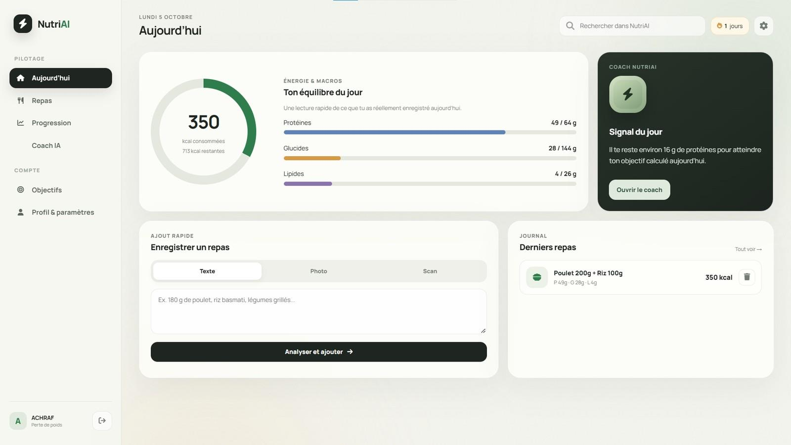
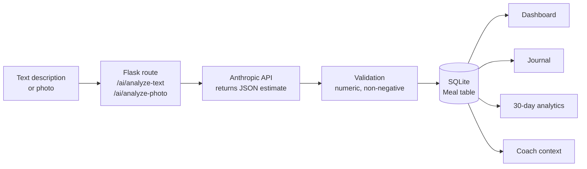
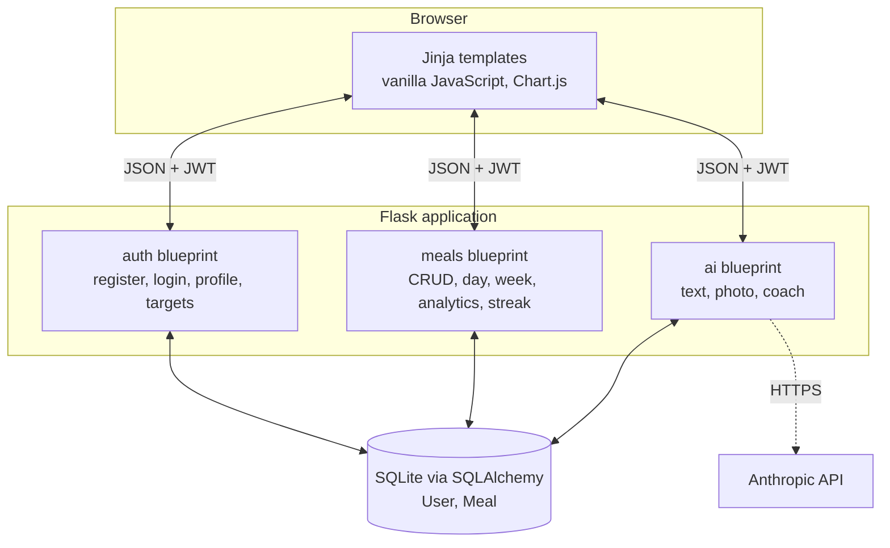
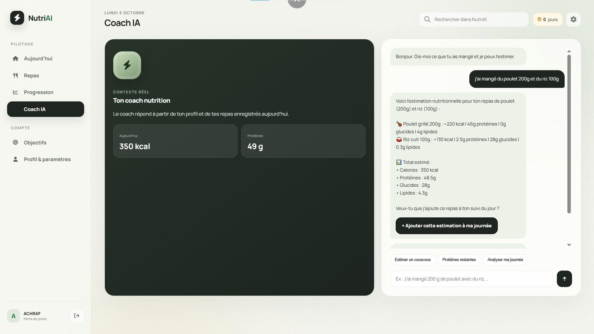
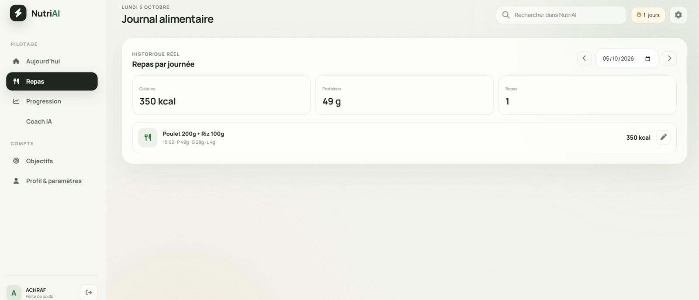
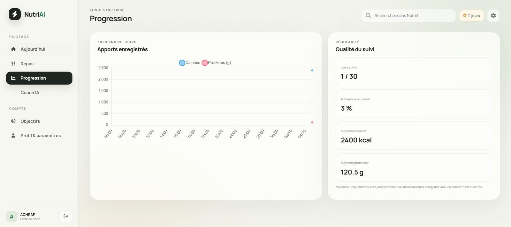
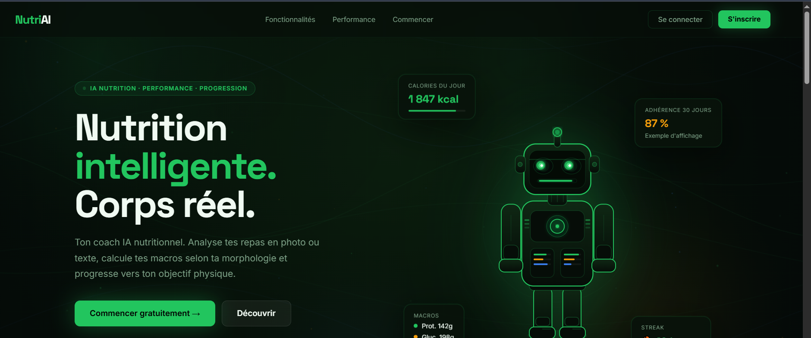

# NutriAI

A nutrition-tracking web application: log a meal by describing it or photographing it, get an estimate of calories and macronutrients, and follow your intake over time. A context-aware coach answers questions using your profile and the meals you logged that day.

Personal project, designed and built solo with Flask.

> **Not medical advice.** Nutritional values are estimates produced by a language model from a description or a photo. They are not measurements and must not be used for medical or dietary decisions.



> The user interface is in French. This README is in English.

## Features

- **Accounts and profile**: sign-up, login, onboarding with age, weight, height and goal.
- **Meal logging from text**: a free-text description is sent to the model, which returns calories, protein, carbs and fat.
- **Meal logging from a photo**: the image is analysed by a vision model and the estimate is stored as a meal.
- **Food journal**: meals by date, with edit and delete.
- **Daily dashboard**: totals of the day against targets derived from the profile.
- **30-day analytics**: daily calories and protein, logged days, adherence, averages and current streak.
- **Coach**: answers a question using the profile and the meals logged today, can estimate a meal mentioned in the conversation and offers to add it to the journal after confirmation.

## How a meal flows through the app



## Architecture



| Area | Endpoints |
|---|---|
| Auth | `POST /auth/register`, `POST /auth/login`, `GET / POST / PUT /auth/profile` |
| Meals | `POST /meals/meal`, `PUT / DELETE /meals/meal/<id>`, `GET /meals/today`, `/meals/day`, `/meals/week`, `/meals/analytics`, `/meals/streak` |
| AI | `POST /ai/analyze-text`, `POST /ai/analyze-photo`, `POST /ai/coach` |

## Tech stack

**Backend:** Python 3.11, Flask, Flask-SQLAlchemy, Flask-JWT-Extended, SQLite
**Frontend:** Jinja templates, vanilla JavaScript, Chart.js
**AI:** Anthropic API (text and vision)

## Design choices

- **Passwords are hashed** with Werkzeug; they are never stored in clear text.
- **Every meal query is filtered by the authenticated user**, so one account cannot read, edit or delete another account's meals.
- **Inputs are validated server-side**: profile values within plausible bounds, nutritional values numeric and bounded, uploads limited to JPEG, PNG and WebP up to 8 MB.
- **The coach never writes to the journal on its own.** An estimate made in conversation is only stored after the user confirms it.
- **Targets are presented as estimates**, computed with the Harris-Benedict equation and a moderate-activity factor.
- **The app runs without an API key.** AI routes then return a clear "not configured" error, and the rest of the app works.

## Screenshots

| Coach | Food journal |
|---|---|
|  |  |

| 30-day progress | Landing page |
|---|---|
|  |  |

## Getting started

Requirements: Python 3.11.

```bash
python -m venv .venv
.venv\Scripts\activate          # Windows; on macOS / Linux: source .venv/bin/activate
pip install -r requirements.txt
```

Copy `.env.example` to `.env` and fill in the three values:

| Variable | Purpose |
|---|---|
| `SECRET_KEY` | Flask secret |
| `JWT_SECRET_KEY` | Signs the login tokens |
| `ANTHROPIC_API_KEY` | Enables text analysis, photo analysis and the coach |

Then start the app:

```bash
python app.py
```

Open `http://127.0.0.1:5000`. The SQLite database is created automatically on first launch.

## Project structure

```
nutriai/
├── app.py              # application factory, page routes
├── config.py           # configuration from environment variables
├── models.py           # User and Meal models
├── routes/
│   ├── auth.py         # accounts, profile, daily targets
│   ├── meals.py        # journal, day and week summaries, analytics, streak
│   └── ai.py           # text analysis, photo analysis, coach
├── templates/          # Jinja pages
├── static/             # CSS and JavaScript
└── docs/screenshots/
```

## Limitations

- **Estimates, not measurements.** Results depend on how precise the description is and on what is visible in the photo. Sauces, oils and real portion weights are easy to miss.
- **No nutritional database.** Values come from the model, not from a reference source such as Ciqual or FoodData Central.
- **Targets use a single formula** (the male Harris-Benedict equation, moderate activity) for every user. Sex and activity level are not part of the profile.
- **An image with no food is still logged**, as a 0 kcal entry. It should be rejected instead.
- **The "Scan" tab reuses the photo analysis.** There is no barcode reader and no product database.
- **Dates are stored in UTC and compared with the server's local date**, so a meal logged shortly after midnight can land on the previous day.
- **Login tokens are stored in the browser's local storage** and expire after 15 minutes, with no refresh.
- **No rate limiting** on the AI routes, no database migrations, no automated tests.
- **Local prototype.** SQLite and the Flask development server are not meant for a deployed, multi-user service.

## Roadmap

- Look up recognised foods in an official nutritional database
- Reject empty analyses instead of logging them
- Add sex and activity level to the profile and to the target formula
- Store timestamps with time zones
- Automated tests for the meals and auth routes
- Rate limiting on AI routes

## Author

**Achraf El Hani** · [GitHub](https://github.com/achrafelhani) · [LinkedIn](https://www.linkedin.com/in/achrafelhani)

## License

All rights reserved. The code is published for reading and evaluation.
